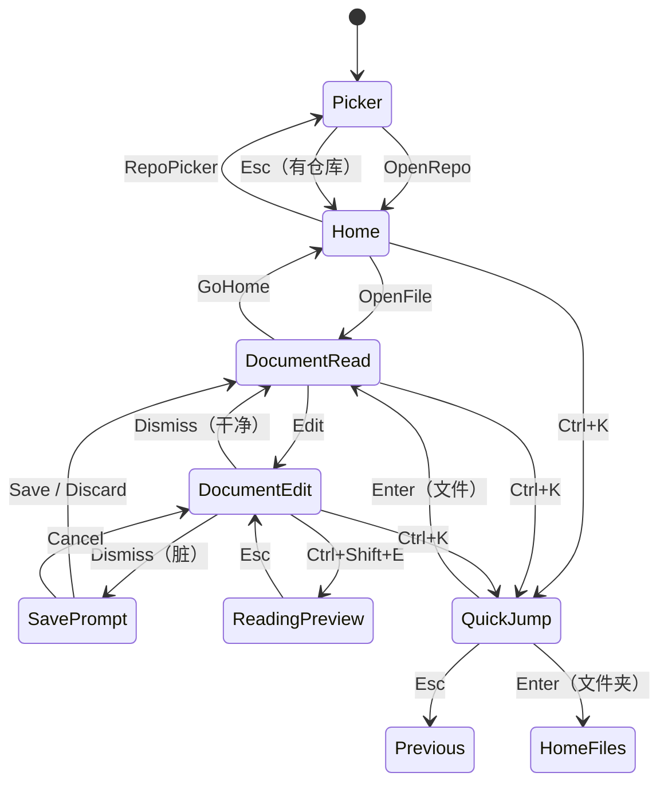

# Tinta 交互状态机与命令契约

> 状态：`[提案]`（交互规则的目标形态；当前代码状态见 [dev-status.md](dev-status.md)）
>
> **唯一职责**：界面状态、焦点、命令、状态转换、异常反馈。
> **不负责**：工作区数据归属、Effect 执行、索引实现（见 [input-workspace-model.md](input-workspace-model.md)）。

## 0. 一条主循环

```text
打开 → 定位 → 阅读 → 编辑 → 保存 → 回到定位/管理
```

阅读、编辑、管理不是三个软件，而是同一条循环上的三个动词：
管理负责定位和整理，阅读负责看，编辑负责改和存。

## 1. 状态模型：状态元组 + 派生焦点

不要把这些状态平铺成一个巨大的枚举，也不要再用“三个正交维度”这种容易和子状态混淆的说法。统一成一个**状态元组 + 派生焦点**：

```text
InteractionState
├─ Base
│  ├─ Surface        Home | Document
│  ├─ HomeScreen     Picker | Files          （仅 Surface = Home）
│  ├─ DocumentMode   Read | Edit             （仅 Surface = Document）
│  └─ EditorView     Source | Split | ReadingPreview  （仅 DocumentMode = Edit）
├─ Overlay           None | QuickJump | Settings | Search | Help | Menu
├─ Modal             None | SavePrompt | ConfirmDelete
└─ Focus             派生：Modal > Overlay > Text > Base
```

- 只有 **Base** 是“页面”；Overlay/Modal 是叠加层，不改变 Base。
- `QuickJump` 不是第五个主状态，是 `Overlay = QuickJump`。
- `ReadingPreview` 不是主状态，是 `EditorView = ReadingPreview`。
- `Text` 焦点不是单独轴，是当前 Base/Overlay 内部的一个输入归属。

## 2. 四个主状态

| 主状态 | 说明 | 子状态 |
| --- | --- | --- |
| `Home.Picker` | 仓库选择 | — |
| `Home.Files` | 目录/文件管理 | 列选择、过滤 |
| `Document.Read` | 阅读 | — |
| `Document.Edit` | 编辑 | `EditorView = Source / Split / ReadingPreview` |

叠加层：

- `Overlay = QuickJump / Settings / Search / Help / Menu`
- `Modal = SavePrompt / ConfirmDelete`

## 3. 焦点与输入分类

```text
Modal > Overlay > Text > Base
```

- 上层消费，下层看不到；上层不消费，才往下走。
- `Esc` 是 `Dismiss` 命令，从栈顶往下找第一个愿意关闭的层；**永不退出软件**。
- `Q` / 窗口关闭 / `Alt+F4` 是 `Quit` 命令，和 `Dismiss` 分开。

输入分两类：

| 类型 | 例子 | 路由 |
| --- | --- | --- |
| Text | 字母、数字、标点、Backspace | 有文本焦点给文本；否则给 Base |
| Command chord | `Ctrl+S`、`Ctrl+K`、`Ctrl+Shift+O`、`F11` | 文本控件先声明是否占用，否则走全局/Base 命令表 |

## 4. 命令表

命令是动词，键位是绑定。第一期只把工作区命令表定下来；编辑器内部键位先保持现状。

| Command | 作用域 | 默认键 | 可配置 | 状态 |
| --- | --- | --- | --- | --- |
| `Dismiss` | Global | `Esc` | 固定 | `[已验证]`（Home/Picker/阅读页；阅读页 GoHome 已接） |
| `Quit` | App | `Q` | 是 | `[现状]` |
| `Help` | App | `?` / `F1` | 是 | `[现状]` |
| `OpenSettings` | App | `Ctrl+,` | 固定 | `[现状]` |
| `QuickJump` | Global（Home/Document） | `Ctrl+K` | 第一期固定 | `[已验证]` |
| `RepoPicker` | Workspace | `o` | 固定 | `[现状]` |
| `ClipCopy` / `ClipCut` / `ClipPaste` | Home.Files | `Ctrl+C` / `Ctrl+X` / `Ctrl+V` | 固定 | `[已验证]` |
| `DeleteSelection` | Home.Files | `D` / `Delete` | 固定 | `[已验证]` |
| `ResolvePasteConflicts` | Home.PasteConflicts | `Enter` / `O` / `Esc` | 固定 | `[已验证]` |
| `RelocateRepo` | Home.Picker | `r` | 固定 | `[已验证]` |
| `SetDefaultRepo` | Home.Picker | `d` | 固定 | `[已验证]` |
| `ForgetRepo` | Home.Picker | `x` / `Delete` ×2 | 固定 | `[已验证]` |
| `GoHome` | Document | `Esc` | 固定 | `[已验证]` |
| `MoveUp` / `MoveDown` | Home/Picker | `k` / `j` | profile | `[现状]` |
| `OpenEntry` | Home/Picker | `Enter` / `l` / `→` | profile | `[现状]` |
| `GoBack` | Home | `h` / `←` / `Backspace` | profile | `[现状]` |
| `NewEntry` | Home | `n` | 固定 | `[已验证]` |
| `RenameEntry` | Home | `r` | 固定 | `[已验证]` |
| `DeleteEntry` | Home | `d` | 固定 | `[已验证]` |
| `Search` | Global | `F` 或 `/` | 是 | `[现状]` |
| `EditDocument` | Document | `E` | 是 | `[现状]` |
| `ToggleTheme` | App | `T` | 是 | `[现状]` |

## 5. 解析顺序

```text
event = read()
if modal consumes(event): return
if overlay consumes(event): return

if event is text:
    if text focus: text.handle(event); return
    if base handles text: return

if event is command chord:
    if text claims chord (Ctrl+C/V/Z/...): text.handle; return
    if global command matches: dispatch; return
    if base command matches: dispatch; return

if base consumes(event): return
// 什么都不做，不要偷偷 Quit
```

## 6. 状态图

`Previous` 是伪状态，表示关闭 Overlay 后回到打开前的 Base；不是新的页面。



一致性规则：

- `QuickJump` 从 Home 打开，Esc 回 Home；从 Document.Read 打开，Esc 回 Document.Read；从 Document.Edit 打开，Esc 回 Document.Edit。**不是一律回 Home。**
- `QuickJump` 按 Enter 打开/激活文件后，Base 变为 `Document.Read`；原来的编辑缓冲留在自己的 tab 里，不丢。不会新开窗口，已打开的文件只激活原标签。
- `QuickJump` 选中文件夹按 Enter 后，Base 变为 `Home.Files` 并定位到该目录（从 Picker 打开也一样）。
- `ReadingPreview` 是 `Document.Edit` 的子视图；Esc 回 `EditorView = Source`，不是回 `Document.Read`。
- `Document.Edit` 的 `Dismiss` 是**单次 Esc**（已确认）：干净缓冲直接回 `Document.Read`；脏缓冲进入 `SavePrompt`，不静默丢弃。旧的双击保护不再作为默认行为。

## 7. 转换表（V1）

| From | Event | Guard | To | Effect |
| --- | --- | --- | --- | --- |
| `Home.Picker` | `OpenRepo` | 仓库存在 | `Home.Files` | 载入 lastDir、扫描目录 |
| `Home.Picker` | `RelocateRepo` | 选中行 missing | `Home.Files` | 选目录 → 更新 settings → 打开仓库 |
| `Home.Picker` | `SetDefaultRepo` | 选中行存在 | `Home.Picker` | currentRepoId=选中；startupMode=last；保存 settings |
| `Home.Picker` | `ForgetRepo` | 同一行第二次 `x` | `Home.Picker` | 从 settings 移除；磁盘文件夹不动 |
| `Home.Picker` | `Dismiss` | 有当前仓库 | `Home.Files` | 无 |
| `Home.Files` | `RepoPicker` | — | `Home.Picker` | 记住 lastDir |
| `Home.Files` | `OpenDir` | 目录可读 | `Home.Files` | 压入新列 |
| `Home.Files` | `OpenFile` | 文件存在且受支持 | `Document.Read` | 打开/激活 tab |
| `Home.Files` | `ClipPaste` | 剪贴板非空、无重名 | `Home.Files` | 复制/移动 → 刷新 |
| `Home.Files` | `ClipPaste` | 剪贴板非空、有重名 | `Home.PasteConflicts` | 紧凑卡片列出冲突，等待 Enter/O/Esc |
| `Home.PasteConflicts` | `Skip` | — | `Home.Files` | 保留旧文件，只贴非冲突项 |
| `Home.PasteConflicts` | `Overwrite` | — | `Home.Files` | 覆盖同名文件（仅文件） |
| `Home.Files` | `DeleteSelection` | 有选中项 | `Home.Files` | 确认 `Move N items…` → 回收站 → 刷新 |
| `Home.Files` | `NewEntry` | — | `Home.Files` | 列表顶部临时行内联命名 → 写盘 → 刷新 |
| `Home.Files` | `RenameEntry` | 有选中项 | `Home.Files` | 原行内联编辑 → 校验 → 重命名 → 刷新 |
| `Home.Files` | `DeleteEntry` | 有选中项 | `Home.Files` | 确认 → 回收站 → 刷新 |
| `Home.Files` | `QuickJump` | 索引可用/可构建 | Overlay=QuickJump | 打开浮层 |
| `Document.Read` | `EditDocument` | 有文件 | `Document.Edit` | 读源码 |
| `Document.Edit` | `Dismiss` | 干净 | `Document.Read` | 重载文件 |
| `Document.Edit` | `Dismiss` | 脏 | Modal=SavePrompt | 打开询问 |
| `Modal.SavePrompt` | Save | — | `Document.Read` | 保存 → 退出编辑 |
| `Modal.SavePrompt` | Discard | — | `Document.Read` | 丢弃 → 退出编辑 |
| `Modal.SavePrompt` | Cancel | — | `Document.Edit` | 留在编辑 |
| `Document.Edit` | `Ctrl+Shift+E` | — | `EditorView=ReadingPreview` | 重新解析 |
| `EditorView=ReadingPreview` | `Dismiss` | — | `EditorView=Source` | 回源码 |
| `Document.*` | `GoHome` | 首页标签存在 | `Home.Files` | 激活首页标签 |
| `Home.Files` / `Document.*` | `QuickJump` | — | Overlay=QuickJump | 记录 Previous Base |
| Overlay=QuickJump | `Dismiss` | — | `Previous Base` | 关闭浮层，无其他变化 |
| Overlay=QuickJump | `OpenEntry` | 选中文件 | `Document.Read` | 关闭浮层 + 打开/激活当前窗口的 tab |
| Overlay=QuickJump | `OpenEntry` | 选中文件夹 | `Home.Files` | 关闭浮层 + Home 定位到目录 |
| Any | `OpenSettings` | — | Overlay=Settings | 打开设置 |
| Overlay=Settings | `Dismiss` | — | `Previous Base` | 关闭设置 |
| Any | `Quit` | 脏缓冲已处理 | — | 关窗 |

P1b 已实现 `NewEntry` / `RenameEntry` / `DeleteEntry` 的 Home 模态：校验、重名错误、删除到回收站；验证见 `dev-status.md` V09。

## 8. 守卫

- `repoExists`
- `pathInsideRepo`
- `fileExists`
- `fileSupported`
- `hasSelection`
- `isDirty`
- `homeTabExists`
- `indexReady`（QuickJump 可先显示部分结果）
- `canWriteDirectory`
- `confirmDelete`

守卫失败必须产生可见反馈，见第 9 节。

## 9. 异常反馈

| 情况 | 反馈 | 状态 |
| --- | --- | --- |
| 仓库路径丢失（启动） | 回 Picker + 红字路径 + 重新定位/移除 | `[现状]` 已有提示，无重新定位 |
| 仓库路径丢失（运行中） | 回到 Picker 或红字提示 + 重新定位 | `[提案]` |
| 文件打开失败 | 状态栏/提示，不进入文档 | `[现状]` 部分 |
| 不支持的文件 | 灰色，不能打开 | `[现状]` |
| 设置写失败 | 设置页/首页底部红字 + 路径 | `[现状]` 部分路径静默 |
| 文件夹选择框取消 | 无提示，保持原状态 | `[现状]` |
| 文件夹选择框系统错误 | 显示错误码/错误信息 | `[提案]` |
| 新建/重命名失败 | 内联编辑不退出，错误显示在底部状态栏 | `[已验证]` |
| 删除失败 | 确认框内/底部错误，不刷新成“已删除” | `[提案]` |
| 索引扫描中 | QuickJump 显示“正在索引”，Esc 可关闭；已有缓存结果继续可用 | `[已验证]` |
| 索引失败 | QuickJump 显示错误码 + 路径，F5 重试 | `[已验证]` |

## 10. 交互不变量

完整不变量由 [design-constitution.md](design-constitution.md) 拥有；这里只列交互层：

- Esc 只 `Dismiss`，永不 `Quit`。
- Overlay/Modal 不改变 Base；关闭后回到 Previous Base。
- 脏缓冲离开编辑必须经过 SavePrompt。
- 首页标签固定，文档标签切换不丢缓冲。
- 守卫失败不得静默。

## 11. V1 验收走查

```text
启动 → Home
  → 新建文件夹 / 新建文件
  → 打开文件阅读
  → E 编辑
  → 输入 + Ctrl+S
  → Esc 回阅读
  → Esc 回 Home
  → 重命名
  → 删除到回收站（确认）
  → Ctrl+K 打开另一个文件
  → 关窗重开，session 恢复
```

## 12. 和现有代码的映射

| 现在 | 状态机里的位置 | 状态 |
| --- | --- | --- |
| `HomeScreen` + `HomeState` | `Home.Picker` / `Home.Files` | `[现状]` |
| `currentFile` + `DocTab` | `Document.Read/Edit` | `[现状]` |
| `editMode` | `DocumentMode = Edit` | `[现状]` |
| `editorReadingPreview` | `EditorView = ReadingPreview` | `[现状]` |
| `showFolderBrowser` / `showSearch` / `showSettings` | Overlay | `[现状]`，优先级未统一 |
| `home_logic` | Workspace transitions | `[现状]` |
| `tabs.cpp` | Document transitions | `[现状]` |
| `input.cpp` | Focus/Command 路由 | `[现状]`，待收薄 |

## 13. 变更协议

- 改状态、焦点、命令、转换：只改本文件 + 对应测试；同时更新 `dev-status.md`。
- 改数据归属、Effect、索引：只改 [input-workspace-model.md](input-workspace-model.md)。
- 改原则/不变量/模块边界：只改 [design-constitution.md](design-constitution.md)。
- 不要在多个文档里各写一版转换表或命令表。
